<p>
  <picture>
    <source media="(prefers-color-scheme: dark)" srcset="docs/images/kerf-audio-horizontal-on-dark.svg">
    
  </picture>
</p>

# Analyse 1

**A free metering and analysis strip for REAPER.** Loudness, level, stereo
image, the waveform and the spectrum, all at once and all live, docked along the
top of REAPER's main window.

There's no plugin to insert and nothing to arm. Analyse 1 listens to REAPER's
output directly, after the master bus and its effects, so whatever you hear is
what you see. Open the panel and it starts working.

A thank-you to the REAPER community, which has inspired me since 2007.

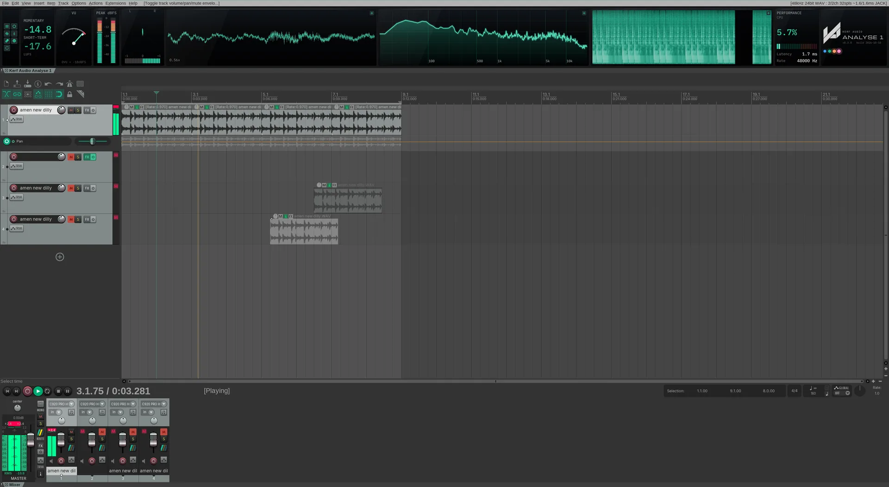

> [!IMPORTANT]
> **Free public beta, version 0.5.0. Available now for Windows and Linux; macOS
> is coming soon.** Analyse 1 has been through extensive code review. It's a beta
> because it hasn't yet been widely used in real-world projects, so please report
> anything that doesn't look right, especially a reading that disagrees with a
> meter you trust.

| | |
| --- | --- |
| **Version** | 0.5.0 beta |
| **Available now** | Windows 10 and 11 (x64), Linux (x86_64, glibc 2.35+) |
| **Coming soon** | macOS 11+ (Apple Silicon and Intel) |
| **Requires** | REAPER 7.8 or later, 64-bit, and [ReaPack](https://reapack.com) |
| **Price** | Free, including for commercial work |
| **Documentation** | [Install guide (PDF)](docs/kerf-analyse-1-install-guide.pdf) · [User manual (PDF)](docs/kerf-analyse-1-manual.pdf) |

## Install

Install with ReaPack. It installs the right build for your system and keeps it up to date.

1. Install [ReaPack](https://reapack.com) if you don't have it, and restart REAPER.
2. Choose **Extensions › ReaPack › Import repositories…**, paste this address and
   click OK. Skip this if you've already added it for Kerf Modulators.
   ```
   https://raw.githubusercontent.com/Kerf-Audio/reapack/main/index.xml
   ```
3. Choose **Extensions › ReaPack › Browse packages**, search for **Analyse 1**,
   right-click it, choose **Install**, then click **Apply**.
4. Restart REAPER.
5. Open the panel from **Extensions › Kerf Audio Analyse 1: Show/hide panel**
   On Windows and Linux there's no shortcut to begin with; add one under
   **Actions › Show action list**.

The strip moves itself to a docker at the top of the main window the first time
it opens, and the height settles after REAPER's next restart. You can also install
by hand from [Releases](../../releases). See [INSTALL.md](INSTALL.md) for that, and for
upgrading and uninstalling.

## The strip

Choose which modules show, drag them into order, set each one's width, and save
layouts by name. Pop any module out into its own window, on a second screen if
you like.

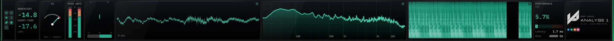

## Modules

| | |
| --- | --- |
| 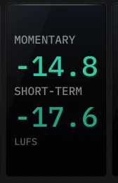 | **LUFS.** Momentary (400 ms) and short-term (3 s) loudness, to ITU-R BS.1770-4 and EBU R128. The loudness streaming services measure. |
| 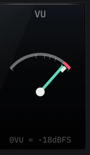 | **VU.** A classic needle with proper 300 ms ballistics, 0 VU at −18 dBFS. Shows the weight of the mix rather than every transient. |
| 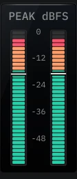 | **Peak.** Fast left and right peak meters with RMS markers. Click the label to switch between dBFS, K-12, K-14 and K-20. |
| 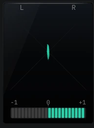 | **Goniometer.** A stereo vector scope with a phase-correlation meter, so out-of-phase material that would vanish in mono shows straight away. |
| 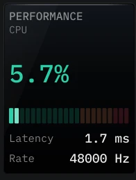 | **Performance.** CPU use, output latency and the device sample rate, which every measurement is based on. |
| 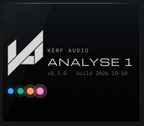 | **Brand.** The Kerf Audio mark with the exact version and build date you're running, the most useful thing to include in a bug report. |

### Scope
An oscilloscope that triggers on rising zero crossings, so a steady tone stands
still. Scroll to zoom the time axis.

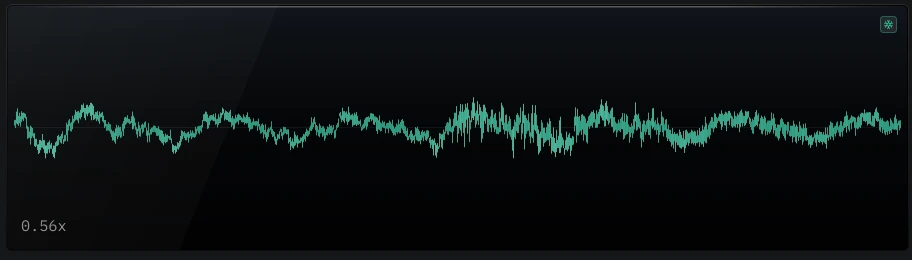

### Spectrum
A live analyser from 20 Hz to 20 kHz on a fixed logarithmic scale. Hover to read
frequency, nearest note and level.

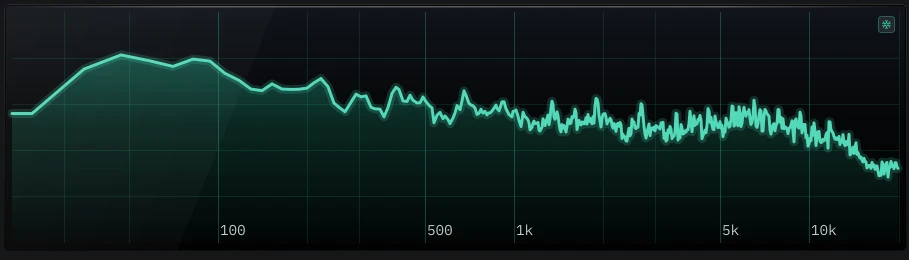

### Spectrogram
The spectrum over time as a scrolling waterfall, for resonances, ringing tails
and noise that flash past too quickly to see. Hover to read frequency, note,
level and how long ago.

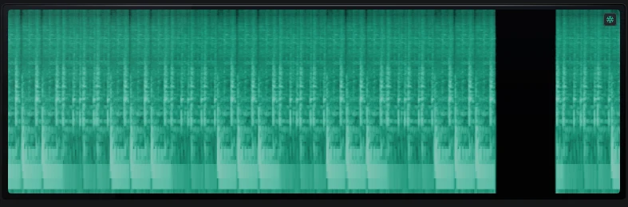

## Features

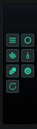

- Show, hide, reorder and resize modules, and save named layouts
- Pop any module out into its own resizable window
- Freeze any module, or every module at the same instant
- **Mono**, **LF solo** and **Dim** on the listening path only, so they never end up in a render
- **Master FX bypass**, to compare with and without your master processing
- Hover readouts of frequency, note and level on the spectrum and spectrogram
- Four accent colours, including one that follows your REAPER theme, in light or dark
- No plugin to insert; switch analysis off and it uses no processor time
- The audio thread only copies samples, never waits or locks, so it can't cause a dropout

The [user manual](docs/kerf-analyse-1-manual.pdf) covers every control.

## How it's made

I have a real software development background and have been involved in the
music industry for over 30 years. This isn't vibe-coded. I used AI assistance,
but as part of a hybrid workflow with a person in charge at every step: a proper
development process, human oversight of every change, code reviews, and testing
in REAPER. It's still a beta and there will be issues. That is exactly why I
want the REAPER community testing it.

## Support and bugs

- **Bugs:** [open an issue](../../issues/new/choose). The form asks for your
  system, REAPER version, sample rate and the version shown in the Brand module.
  If a reading looks wrong, say which meter you compared it with.
- **Questions:** ask in [Discussions](../../discussions).
- Support is through GitHub only. I read every report and fix what I can, as
  time allows, but there's no guaranteed timescale.

## Roadmap: testing first

This first release phase is for testing and bug fixing. **No new features will
be added until version 1.0 is out and stable.** Feature requests are welcome in
[Discussions](../../discussions) or as an issue, and they'll be looked at after
1.0.

## Licence

Analyse 1 is free to use, including for commercial work, under the
[Kerf Audio Freeware Licence](LICENSE.txt). It is not open source, and it may not
be sold or redistributed; please link here instead. Third-party components are
listed in [THIRD-PARTY-NOTICES.txt](THIRD-PARTY-NOTICES.txt).

REAPER is a trademark of Cockos Incorporated. Kerf Audio is not affiliated with
or endorsed by Cockos.

Danny Wincott, trading as Kerf Audio
